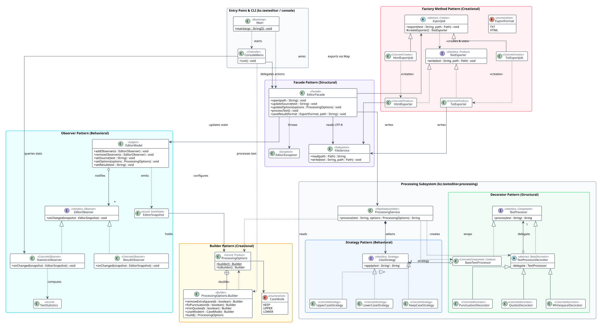
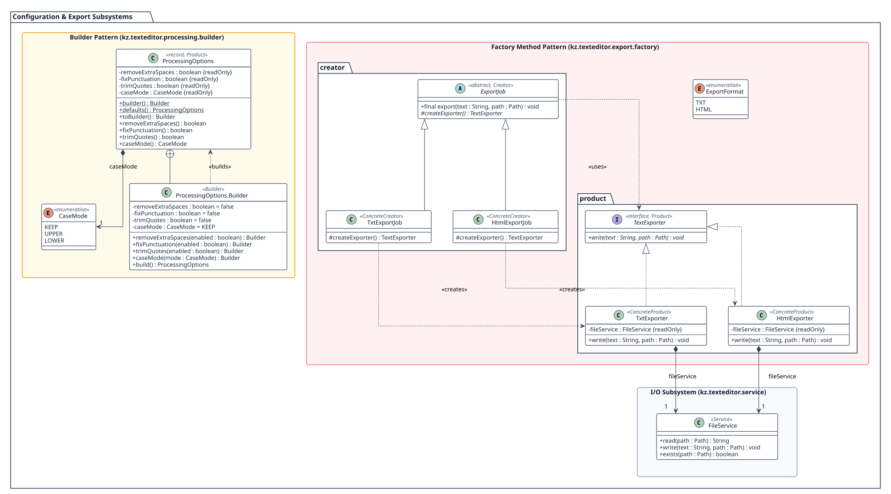
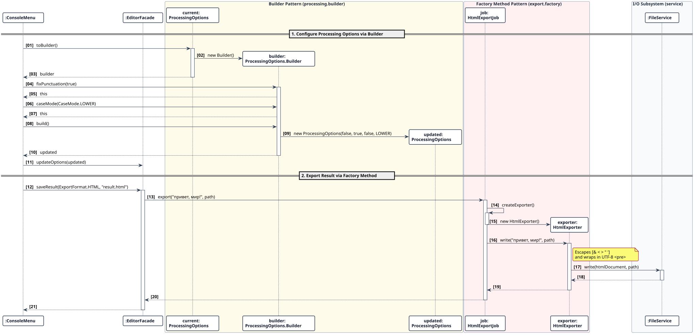
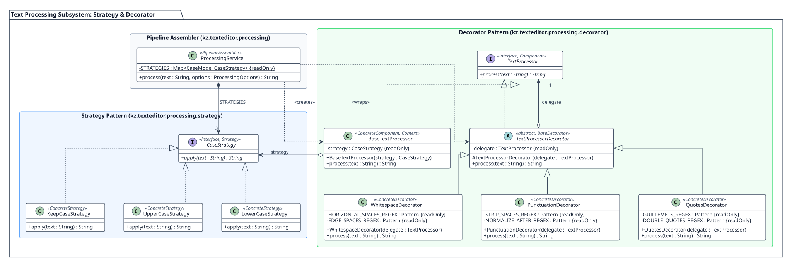
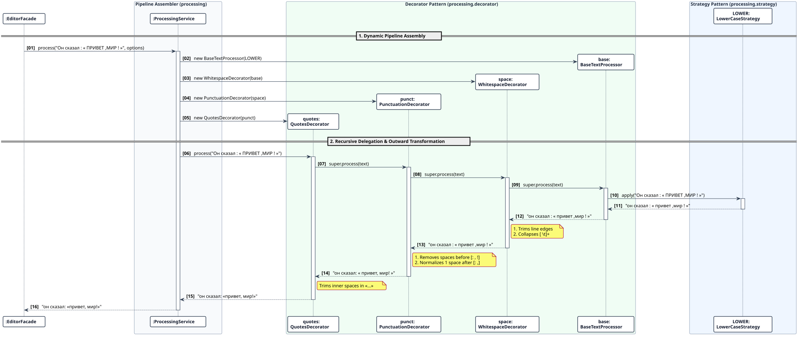
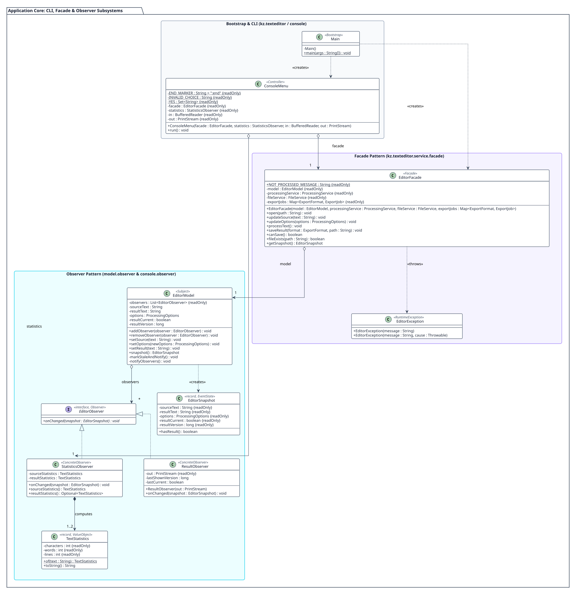
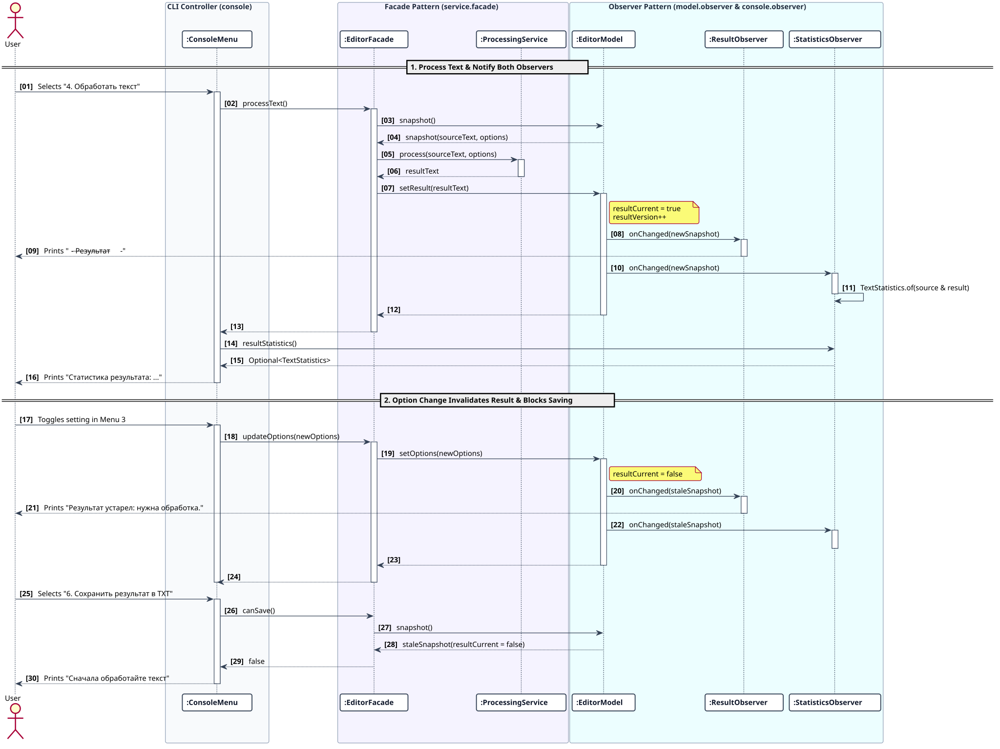

# htx-edit

`htx-edit` is a command-line text processor and editor written in Java 21. It reads text from standard input or UTF-8 `.txt` files, runs it through a configurable formatting pipeline, tracks character/word/line statistics, and exports the result to plain text or escaped HTML.

## Requirements

* Java 21
* Maven 3.9+

## Build and Run

Run the test suite (JUnit 6):

```bash
mvn test
```

Compile and start the interactive CLI:

```bash
mvn compile exec:java -Dexec.mainClass="kz.texteditor.Main"
```

Or run directly after compiling:

```bash
mvn test-compile
java -cp target/classes kz.texteditor.Main
```

## Usage

The editor runs in an interactive loop in the terminal:

1. **Enter or replace text (`1`)**: Type or paste multi-line text. Enter `:end` on a new line by itself to finish input.
2. **Open TXT (`2`)**: Load a UTF-8 `.txt` file (for example, `samples/input.txt`). `CRLF` and `CR` line endings are normalized to `LF` on read.
3. **Configure rules (`3`)**: Toggle formatting rules on or off and select the letter-case mode. All rules are disabled by default.
4. **Process text (`4`)**: Runs the active rules against the source text, prints the output, and updates statistics.
5. **Compare source and result (`5`)**: Prints both the original text and the latest processed result along with their statistics (Unicode code points, whitespace-delimited words, and `LF` line count).
6. **Save to TXT / HTML (`6`, `7`)**: Writes the processed result to disk in UTF-8. HTML output escapes `<`, `>`, `&`, `"`, and `'` and wraps the text in a `<pre>` block. Saving is blocked if the source text or settings were modified after the last processing run.

## Processing Rules

Every processing run starts from the original source text and applies enabled rules in a fixed order:

`Case -> Extra Spaces -> Punctuation -> Paired Quotes`

| Rule | Behavior | Example |
| :--- | :--- | :--- |
| **Case** (`KEEP`, `UPPER`, `LOWER`) | Converts letter case using `Locale.ROOT` (supports English, Russian, and Kazakh alphabets). | `Сәлем, World!` -> `сәлем, world!` |
| **Extra Spaces** | Collapses consecutive spaces and tabs into a single space and trims horizontal whitespace at line edges. Preserves empty lines and line breaks. | `  hello   world  ` -> `hello world` |
| **Punctuation** | Removes spaces before `. , ! ? : ;` (including multi-character groups like `...` and `?!`) and normalizes a single space after them, except before line breaks, end of text, or closing quotes. | `Подожди ...что ?!` -> `Подожди... что?!` |
| **Paired Quotes** | Trims spaces immediately inside paired guillemets (`«...»`) and straight double quotes (`"..."`) on the same line. Unpaired quotes are left untouched. | `« hello world »` -> `«hello world»` |

Combined example (all rules enabled, lowercase):
* Input: `Он сказал : « ПРИВЕТ ,МИР ! »`
* Output: `он сказал: «привет, мир!»`

## Architecture and Design Patterns

The codebase is organized by domain and pattern roles under `kz.texteditor`, with `Main` as the single external entry point wiring the dependencies:

```text
src/main/java/kz/texteditor/
├── Main.java
├── console/
│   ├── ConsoleMenu.java
│   └── observer/          # ResultObserver, StatisticsObserver, TextStatistics
├── model/
│   └── observer/          # EditorModel, EditorObserver, EditorSnapshot
├── service/
│   ├── FileService.java
│   └── facade/            # EditorFacade, EditorException
├── processing/
│   ├── ProcessingService.java
│   ├── builder/           # ProcessingOptions (+ Builder), CaseMode
│   ├── strategy/          # CaseStrategy, Keep/Upper/LowerCaseStrategy
│   └── decorator/         # TextProcessor, BaseTextProcessor, TextProcessorDecorator,
│                          # Whitespace/Punctuation/QuotesDecorator
└── export/
    └── factory/
        ├── ExportFormat.java
        ├── creator/       # ExportJob, TxtExportJob, HtmlExportJob
        └── product/       # TextExporter, TxtExporter, HtmlExporter
```

### Implemented Patterns

* **Builder** (`processing.builder`): Constructs immutable `ProcessingOptions` instances and creates modified copies via `toBuilder()`.
* **Factory Method** (`export.factory`): `ExportJob` defines the export template and defers `TextExporter` instantiation (`TxtExporter`, `HtmlExporter`) to concrete subclasses.
* **Strategy** (`processing.strategy`): Encapsulates interchangeable case-conversion algorithms behind `CaseStrategy` and injects the selected strategy into `BaseTextProcessor`.
* **Decorator** (`processing.decorator`): Wraps `BaseTextProcessor` with `WhitespaceDecorator`, `PunctuationDecorator`, and `QuotesDecorator` at runtime based on active options.
* **Facade** (`service.facade`): `EditorFacade` provides a unified API for `ConsoleMenu`, coordinating the model, processing pipeline, file I/O, and export jobs.
* **Observer** (`model.observer`, `console.observer`): `EditorModel` publishes immutable `EditorSnapshot` state changes to `ResultObserver` and `StatisticsObserver`.

## UML Diagrams

### System Overview

<table>
  <tr>
    <td align="center" bgcolor="#ffffff">
      
    </td>
  </tr>
</table>

<details>
<summary><strong>Builder & Factory Method (Configuration & Export)</strong></summary>
<br>

#### Class Diagram
<table>
  <tr>
    <td align="center" bgcolor="#ffffff">
      
    </td>
  </tr>
</table>

#### Sequence Diagram
<table>
  <tr>
    <td align="center" bgcolor="#ffffff">
      
    </td>
  </tr>
</table>

</details>

<details>
<summary><strong>Strategy & Decorator (Processing Pipeline)</strong></summary>
<br>

#### Class Diagram
<table>
  <tr>
    <td align="center" bgcolor="#ffffff">
      
    </td>
  </tr>
</table>

#### Sequence Diagram
<table>
  <tr>
    <td align="center" bgcolor="#ffffff">
      
    </td>
  </tr>
</table>

</details>

<details>
<summary><strong>Facade & Observer (Application Core & State)</strong></summary>
<br>

#### Class Diagram
<table>
  <tr>
    <td align="center" bgcolor="#ffffff">
      
    </td>
  </tr>
</table>

#### Sequence Diagram
<table>
  <tr>
    <td align="center" bgcolor="#ffffff">
      
    </td>
  </tr>
</table>

</details>


## Development

See [CONTRIBUTING.md](CONTRIBUTING.md) for setup notes, test commands, and commit conventions.